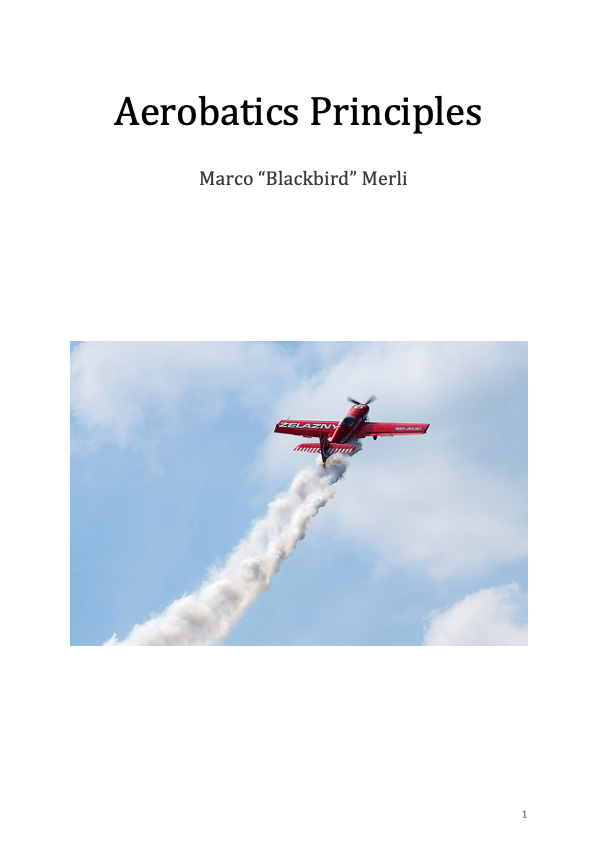
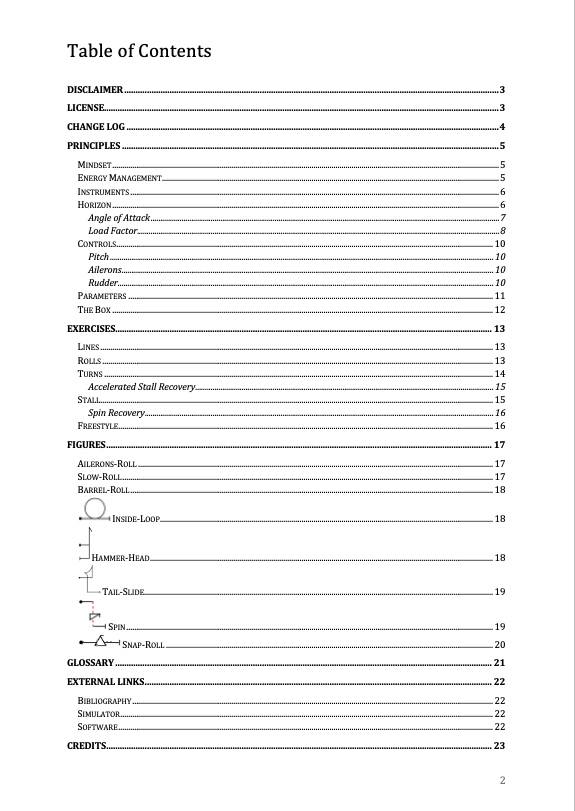
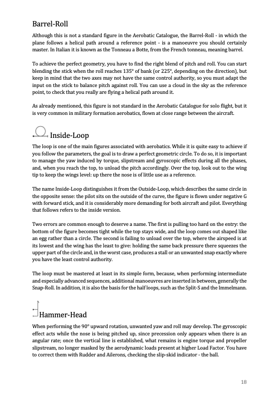
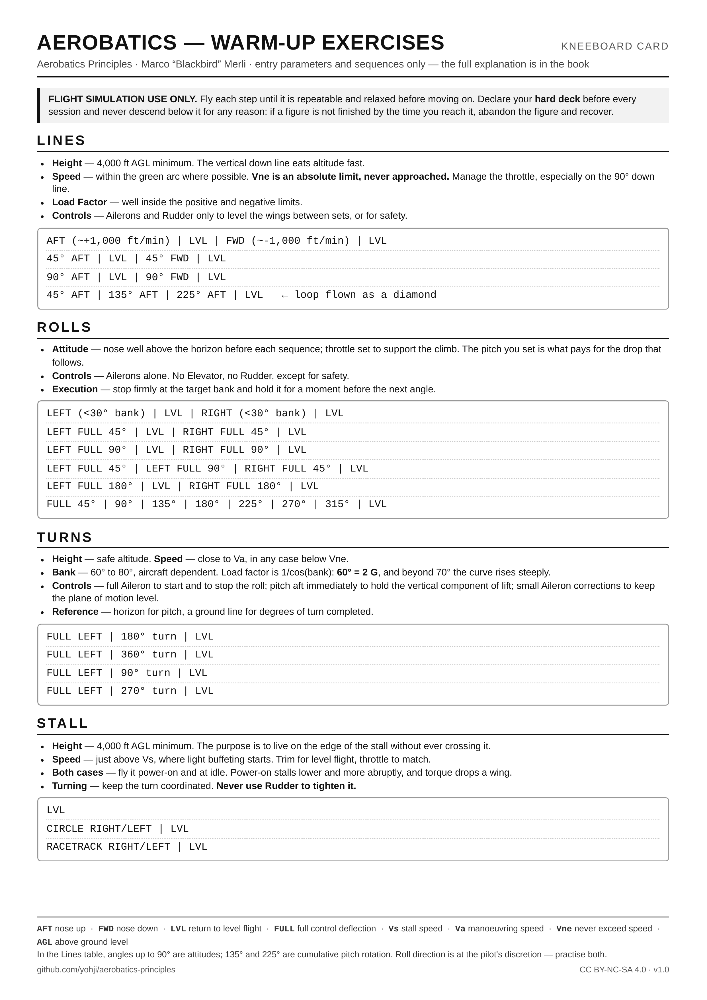

# Aerobatics Principles

**A primer on the principles of aerobatic flight - for flight simulation only.**

> **This publication is intended exclusively for educational and entertainment purposes within the context of flight simulation.** Nothing in it constitutes instruction, guidance or authorisation for performing aerobatic manoeuvres in real-world aviation. See the [full Disclaimer](#disclaimer) below.

---

## Download

**[→ Get the latest version](https://github.com/yohji/aerobatics-principles/releases/latest)**

Every release ships the manual as a PDF, ready to read offline, on a tablet or on a second
monitor. The file name carries no version number: the version is carried by the release, so
the download link never changes and a new edition simply replaces the old file on disk.

Older versions remain available on the [releases page](https://github.com/yohji/aerobatics-principles/releases).

### Source

The `document/` folder holds the book itself, not a copy of it.

* [`Aerobatics_Principles-Marco_Blackbird_Merli.docx`](document/Aerobatics_Principles-Marco_Blackbird_Merli.docx)
  is the manuscript. It is written in Word and it is the single source of truth.
* [`Aerobatics_Principles-Marco_Blackbird_Merli.pdf`](document/Aerobatics_Principles-Marco_Blackbird_Merli.pdf)
  is the current edition, exported from Word - the same file attached to the latest release.

If you want to translate or adapt the book, start from the `.docx`: it is exactly what the
author works on.

---

## What this is

Aerobatics is often taught as a list of figures: pull here, kick there, roll out. This book takes the
opposite route. It explains the framework underneath - how an aircraft moves through space, how
energy is managed and transformed, and how a pilot keeps precise control well beyond the normal
flight envelope - and only then looks at the figures themselves.

It is deliberately short. It is not a substitute for the flight manual of the aircraft you are flying,
and it says so repeatedly: where the two disagree, the flight manual always wins.

## Who it is for

- Simulator pilots who want to fly aerobatic sequences properly rather than by imitation.
- Any virtual pilot who wants better aircraft control in unusual attitudes, aerobatic ambitions or not.
- Anyone approaching military Air Combat Manoeuvres, which inherit much of their vocabulary from aerobatics.
- Real-world aerobatic pilots using a simulator for chair-flying - with the caveat that this book is
  written for the virtual cockpit, and the real one has rules of its own.

## Contents

- **Principles** - Mindset · Energy Management · Instruments (Horizon, Angle of Attack, Load Factor) ·
  Controls (Pitch, Ailerons, Rudder) · Parameters (The Box)
- **Exercises** - Lines · Rolls · Turns (Accelerated Stall Recovery) · Stall (Spin Recovery) · Freestyle
- **Figures** - Ailerons-Roll · Slow-Roll · Barrel-Roll · Inside-Loop · Hammer-Head · Tail-Slide ·
  Spin · Snap-Roll
- **Glossary** - every abbreviation used in the book, in one table
- **External links** - bibliography, simulators, software

## Preview

| Cover | Contents | Figures |
|---|---|---|
|  | | 

### Kneeboard card

The `kneeboard/` folder holds a single A4 page with the warm-up exercises - entry parameters
and sequences only, no explanations. It is meant to be flown with, not read: drop the PNG into
your simulator's kneeboard folder and have the numbers one keypress away in the cockpit.

The card is generated from `kneeboard/Aerobatics_Principles-Exercises.html`, which is included so it can be regenerated,
restyled or translated.

## Simulators

The book is simulator-agnostic - the principles apply to any platform. It was written with
[DCS World](https://www.digitalcombatsimulator.com/) in mind, and the aircraft referenced throughout 
the Christen Eagle II and the MB-339. Aresti sequences can be designed with [OpenAero](https://openaero.net/).

## Errata and contributions

Found a technical error, a typo, or a passage that reads badly?
**[Open an issue](https://github.com/yohji/aerobatics-principles/issues)** - corrections to a
manual like this one are genuinely welcome.

If you want to contribute actively - rewrite a section, add a missing figure, contribute a
diagram, take on a whole chapter - that would be a pleasure. Open a pull request, or simply
write to **marcomerli@marcomerli.net**; a rewritten paragraph in the body of an email is a
perfectly good contribution. See [CONTRIBUTING.md](CONTRIBUTING.md) for the details, including
how to go about a translation.

## Licence

This work is licensed under a
[Creative Commons Attribution-NonCommercial-ShareAlike 4.0 International License](https://creativecommons.org/licenses/by-nc-sa/4.0/)
(CC BY-NC-SA 4.0).

You are free to **share** it and to **adapt** it, including translating it into other languages, provided
that you give appropriate credit, do not use it for commercial purposes, and distribute your
contribution under the same licence. Full text in [LICENSE](LICENSE).

If you mirror the PDF elsewhere, please link back to the
[releases page](https://github.com/yohji/aerobatics-principles/releases/latest) so that readers can
always reach the current version.

## Disclaimer

This publication is intended exclusively for educational and entertainment purposes within the context
of flight simulation. All techniques, manoeuvres, procedures and recommendations described are designed
for use in virtual environments only.

**Under no circumstances should the content of this book be interpreted as instruction, guidance or
authorisation for performing aerobatic manoeuvres in real-world aviation.** Aerobatic flight in actual
aircraft requires formal training, certification, adherence to aviation regulations and strict safety
procedures under the supervision of qualified instructors.

The content is provided **"as is", without warranty of any kind**. The author assumes no responsibility
or liability for any injuries, damages, losses or legal consequences arising from the use or the misuse
of the information provided. The complete Disclaimer is contained in the document itself.

## Author

Marco "Blackbird" Merli
